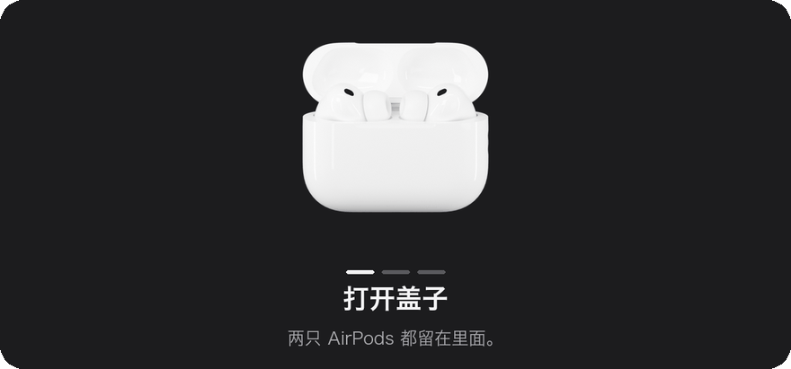
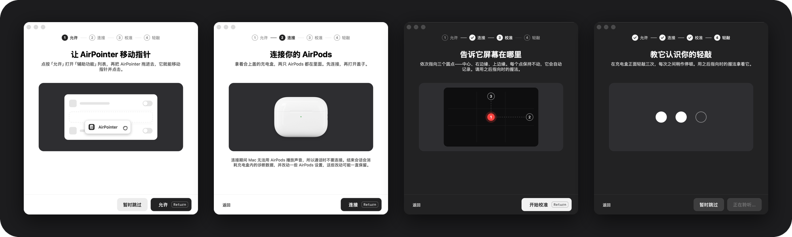
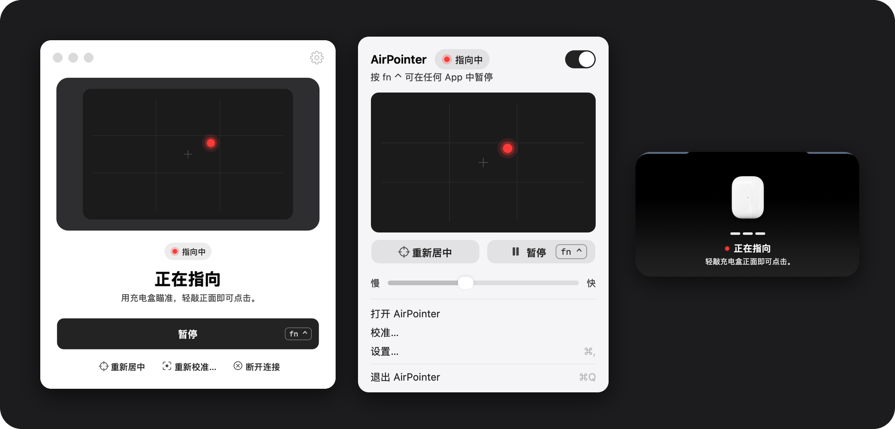

<p align="center">
  
</p>

<h1 align="center">AirPointer</h1>

<p align="center">
  <strong>把 AirPods 充电盒变成 Mac 的指针。</strong><br>
  拿着合上盖的充电盒移动，光标就跟着移动；轻敲盒子正面即可点击。
</p>

<p align="center">
  <strong>简体中文</strong> · <a href="README.en.md">English</a>
</p>

> **关于本仓库**
> 本仓库是上游 [musubipapi/airpointer](https://github.com/musubipapi/airpointer) 的**简体中文汉化版**（非官方分支）。界面文案、系统权限提示、VoiceOver 朗读、连接失败与会话结束原因、全部菜单项，以及这份文档都已译为简体中文；代码逻辑与上游保持一致，另外修复了上游一处编译错误（见文末「汉化改动」）。英文原文见 [README.en.md](README.en.md)。
> 欢迎 Issue / PR，也欢迎把汉化改动合并回上游。

<p align="center">
  
</p>

## 使用前必读

| 影响面 | 会发生什么 |
|---|---|
| **充电盒数据** | 结束一次会话会消耗充电盒中存储的诊断数据。 |
| **AirPods 设置** | 部分 AirPods 连接设置会保持会话设置后的状态。这个改动、以及充电盒数据的改动，在蓝牙链路重置后是否仍然保留，目前尚不明确。 |
| **音频** | 每次连接都会短暂中断 AirPods 的蓝牙链路，声音会停。**通话期间不要连接。** |
| **麦克风** | 会话期间，App 会让 Mac 的声音和麦克风都不走 AirPods；会话结束时恢复。强制退出后，下次打开 App 时若 AirPods 仍连着，会补做恢复。 |
| **静音音频** | 会话期间，App 会向 AirPods 播放静音以维持音频链路，你听不到。 |
| **光标大小** | 小于 2× 的光标在指向时会放大到 2×，暂停或断开后恢复。强制退出后，下次打开 App 时恢复。此处使用了 macOS 私有调用。 |

## 环境要求

| 项目 | 状态 |
|---|---|
| AirPods Pro 3、macOS 26、Apple Silicon | 上游在一台 Mac + 一副 AirPods 上实测通过 |
| AirPods Pro 2 | 可识别，未实测 |
| AirPods 已与这台 Mac 配对 | 必需 |
| Xcode | 构建时需要 |

支持的型号由代码里的产品 ID 白名单决定：`0x2014` / `0x2024`（AirPods Pro 2）、`0x2027`（AirPods Pro 3）。其他型号——AirPods 1/2/3/4、AirPods Pro 1、AirPods Max——不会被识别。连上之后还会校验固件自报的型号字符串：耳机必须是 `AirPods Pro`，充电盒必须是 `AirPods Charging Case`，否则会在连接阶段退出。

上游已反复验证常规的连接与断开。以下情况**未**刻意测试过：

- 会话中强制退出
- 会话中睡眠唤醒
- 会话中蓝牙丢失
- 会话中的通话与音频

> 本汉化版已在 macOS 26 / Xcode 26.5 的 **Intel（x86_64）** 机器上完整编译，`--self-test` 与 `--check-home` 全部通过。理论上与芯片架构无关，但上游只在 Apple Silicon 上跑过。

## 构建与运行

```zsh
zsh ./build.sh
open AirPointer.app
```

构建过程会顺带运行 `--self-test` 和点击检测。其他离线检查见「开发者」一节。**指向会话进行中不要构建。**

> 注意：`build.sh` 结尾会 `lsregister -f` 当前目录的 `AirPointer.app`。如果同时把它拷到了 `/Applications`，之后再在仓库里构建并 `open AirPointer.app`，会跑起两份、菜单栏出现两个图标——只从一处启动即可。

重新构建后，如果 AirPointer 从「辅助功能」列表里失效（表现为一直提示你授权），执行：

```zsh
tccutil reset Accessibility local.airpointer
tccutil reset BluetoothAlways local.airpointer
```

原因：默认的 adhoc 签名下，TCC 记录绑定的是二进制指纹（cdhash），每次重新编译都会变，旧授权就对不上了。

## 首次设置

第一次打开 App，设置分为四步。

<p align="center">
  
</p>

1. **允许**：把 AirPointer 拖进「辅助功能」列表，它才能移动光标和点击。
2. **连接**：打开盖子 → 合上盖子 → 把充电盒放下停一会儿 → 竖直立起来。
3. **校准**：依次指向三个圆点，告诉 App 你的屏幕在哪里。
4. **轻敲**：在充电盒正面轻敲三次。

## 日常使用

在任意 App 中按 **fn ⌃** 连接；再按一次暂停/继续。想换快捷键，到「设置」里改。

<p align="center">
  
</p>

在被测的那副 AirPods 上，合盖约 30 分钟后会话会结束。要继续，打开盖子再合上。见「已知限制」。

**连接流程**

```
按「连接」或 fn ⌃
  → 打开盖子
  → 合上盖子
  → 传感器偏移量已保存？否 → 先把盒子放下停一会儿
  → 竖直立起来
  → 屏幕边缘已保存？否 → 指向三个圆点
  → 开始指向
      按 fn ⌃ → 已暂停 → 再按 fn ⌃ → 继续指向
```

## 已知限制

**合盖约 30 分钟后会话会结束。** 这个限制不是 App 设的。到点后动作数据停止，AirPods 也联系不上，必须打开盖子再合上才能继续。有一次测试中，合盖状态下重连并没有重置这个限制。

最可能的原因是耳机固件里的定时器 `0x63`。上游通过阅读 `rkof.bin`（H2，版本 9A348，即被测 AirPods Pro 3 的固件镜像）定位到：

| 地址 | 作用 |
|---|---|
| `0x17d2a4` | 构造状态掩码。掩码非零、状态检查通过且定时器未运行则启动定时器；掩码为零则取消。 |
| `0x17d326` | 装载定时长度：1,800,000 ms，即 30 分钟。 |
| `0x17d294` | 状态检查：固件里的 dock 状态等于 6，很可能表示「合盖且放在盒中」。 |
| `0x17cddc` | 定时器到期时执行：再次检查状态，然后调用一个不会返回的致命断言。 |

实测会话结束时间高度一致，都在合盖后约 1,805 秒。此结论来自固件阅读与实测计时，尚未有实时抓包确证。

## 故障排查

| 现象 | 处理 |
|---|---|
| 连不上 | 关掉 iPhone 的蓝牙。iPhone 可能会抢占 AirPods。 |
| 一直卡在「连接中」 | 打开盖子并保持打开，直到 App 提示你合上。 |
| 提示没有收到动作数据 | 耳机可能同时连着 iPhone：关掉手机蓝牙，两只耳机都放回盒子、打开盖子，再连一次。 |
| 指针卡顿或动作中断 | 确认没有别的 App（如 OBS、浏览器通话）把 AirPods 当麦克风用。 |
| 刚连上时指针一顿一顿 | 前 20 秒左右属正常。 |
| 「放下它」这一步很久 | 用坚实平整的桌面，别碰盒子。 |
| 轻敲不触发点击 | 设置 → 轻敲教学，重做一次；换了握法就再教一次。 |
| 每次都要重新授权 | 见「构建与运行」里的 `tccutil reset` 一节。 |

## 工作原理

```
AirPods Pro（合盖）          辅助程序                       App
  动作传感器  ──蓝牙──→  ClosedCaseMotion  ──管道──→  ClosedCaseSession
                        （启动传感器、保持唤醒）           ├ Orientation.js   动作→屏幕坐标
  ClosedCaseRestore                                   ├ ClosedCaseTap    识别轻敲
  （拉起蓝牙链路）                                     ├ AudioOutputGuard 声音不走 AirPods
                                                      └ 窗口 / 菜单栏 / 刘海 / 设置
                                                            ↓
                                                       macOS：移动光标、点击
```

1. **连接**：`ClosedCaseRestore` 确保 AirPods 的常规蓝牙链路在线；随后 `ClosedCaseMotion` 再连一次——动作通道只在刚连接后的一小段时间内响应。
2. **传输**：`ClosedCaseMotion` 启动传感器，并持续发送节奏化请求让合盖保持唤醒，把动作数据传给 App。
3. **保活**：App 每秒发一次心跳；App 若停止，辅助程序会关掉传感器并释放占用。
4. **指向**：`Orientation.js` 计算盒子姿态，换算成屏幕坐标。
5. **点击**：`ClosedCaseTap` 寻找「朝轻敲方向的一次突变」，命中则点击，并在 Mac 上播一声短音。

动作数据中断少于两秒时，指针停下后继续；超过两秒则暂停，动作恢复后再继续。

## 项目结构

```
Sources/
  AirPointer/          主程序
    App/               启动、窗口连接、快捷键
    Session/           会话、动作解算、轻敲、音频守卫、光标尺寸
    Interface/         窗口、菜单栏、刘海、设置、轻敲测试
    Checks/            窗口与姿态检查，其余检查与代码同文件
  ClosedCaseMotion/    与 AirPods 通信的辅助程序
  ClosedCaseRestore/   拉起蓝牙链路的辅助程序
Tests/                 录制的轻敲数据与检测用例
Assets/                图片、音效与 3D 充电盒模型
Scripts/               生成图片与 README 图形的脚本
Docs/                  设计规范
build.sh               构建 AirPointer.app 并运行检查
```

`Sources/ClosedCaseMotion/CaseSustainedRenewal.m` 顶部列出了该辅助程序的退出码。界面规则见 [Docs/DESIGN-SYSTEM.md](Docs/DESIGN-SYSTEM.md)，资源说明见 [Assets/README.md](Assets/README.md)。

## 开发者

**Mac 上的数据**

App 的数据在 `~/Library/Application Support/AirPointer/`，不会外发。

| 文件 | 内容 |
|---|---|
| `closed-case-target.txt` | 使用的 AirPods |
| `closed-case-grip.json` | 保存的屏幕边缘 |
| `closed-case-sensor-calibration.json` | 保存的传感器偏移，保留一周 |
| `PointerSessions/` | 最近十次会话日志 |
| `TapTests.jsonl` | 轻敲测试成绩 |

会话期间，App 的偏好设置还会记录它改动过哪些音频设备；记录的名字里包含 AirPods 的蓝牙地址。

会话的 `native.log` 中：

- `STEP` 行是各连接步骤的时间点。
- `HOLD` 行约每秒记录一次动作计数与延迟。
- `tap` 行解释每次轻敲。
- `EXIT` 行说明会话结束原因。

**轻敲测试**

轻敲阈值目前只在一个人身上调过，你的成绩可能不同。连接后进入 **文件 > 开发者 > 轻敲测试**，测试约 75 秒，会提示何时轻敲。

要同时保存会话的原始动作数据，请在连接前执行（不限大小，30 分钟会话约 20 MB）：

```zsh
defaults write local.airpointer recordMotion -bool true
```

**离线检查**

这些检查不使用蓝牙。`--check-home` 会打开真实窗口，需在已登录的图形会话中运行。

```zsh
AirPointer.app/Contents/MacOS/AirPointer --self-test
AirPointer.app/Contents/MacOS/AirPointer --check-home
AirPointer.app/Contents/MacOS/AirPointer --check-pointer-settings
AirPointer.app/Contents/MacOS/AirPointer --check-closed-case-native
AirPointer.app/Contents/MacOS/AirPointer --check-audio-output-policy
AirPointer.app/Contents/MacOS/AirPointer --check-closed-case-tap Tests/TapFixtures.csv
AirPointer.app/Contents/Resources/ClosedCaseMotion.bin --self-test
```

`--check-home --preview-directory <目录>` 还会把每个界面离线渲染成 PNG，调文案或改版式时可以拿来对照。

## 卸载

退出 AirPointer，删除 App，然后执行：

```zsh
rm -rf ~/Library/Application\ Support/AirPointer
defaults delete local.airpointer
tccutil reset Accessibility local.airpointer
tccutil reset BluetoothAlways local.airpointer
```

## 汉化改动

- **界面文案**：主窗口、设置页、四步设置引导、全屏校准、刘海面板、菜单栏面板、HUD 气泡、轻敲测试窗口、辅助功能引导卡片，以及全部菜单项。
- **系统交互文案**：蓝牙权限申请说明（`Info.plist` 的 `NSBluetoothAlwaysUsageDescription`）、VoiceOver 辅助功能标签与朗读文本。
- **错误与状态提示**：`ClosedCaseAirPods` 的全部失败原因、`ClosedCaseSession` 的全部结束原因。
- **文档**：本文件为简体中文版，英文原文保留在 [README.en.md](README.en.md)。
- **内部逻辑不变**：`"Paused"` 这类作为哨兵值参与判断的字符串仍保留英文，只在显示层译为中文；日志与诊断用的内部英文原因也未改动，便于对照上游排查。
- **附带修复上游一处编译错误**：`CaseSustainedRenewal.m` 中 `check(firstSensor, …)` 改为 `check(firstSensor!=nil, …)`，否则 `-Werror` 下 clang 会报 `incompatible pointer to integer conversion`。
- **自检同步**：`Checks/HomeChecks.swift` 与轻敲测试自检里的期望文案改为中文，`--self-test`、`--check-home` 均可通过。

## 许可

代码使用 [MIT License](LICENSE)，但不覆盖 `Assets/`。充电盒图片所用的 AirPods 模型归 Apple 所有，音效有其自己的许可，见 [Assets/LICENSE.md](Assets/LICENSE.md)。
